# Prompt-to-Ontology

[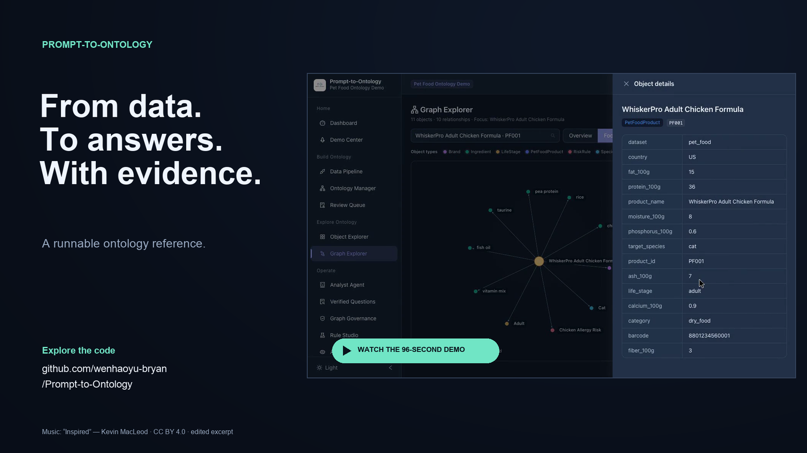](https://github.com/wenhaoyu-bryan/Prompt-to-Ontology/releases/download/v0.3.1/prompt-to-ontology-product-demo.mp4)

**[Watch the 96-second demo](https://github.com/wenhaoyu-bryan/Prompt-to-Ontology/releases/download/v0.3.1/prompt-to-ontology-product-demo.mp4)** · [Download MP4](https://github.com/wenhaoyu-bryan/Prompt-to-Ontology/releases/download/v0.3.1/prompt-to-ontology-product-demo.mp4) · [中文](README.zh-CN.md)

Explore the graph. Map data. Review changes. Trace answers to evidence. Actual product footage with music and on-screen captions.

[](https://github.com/wenhaoyu-bryan/Prompt-to-Ontology/actions/workflows/ci.yml)

[Releases](https://github.com/wenhaoyu-bryan/Prompt-to-Ontology/releases) · [Contributing](CONTRIBUTING.md) · [Release process](docs/releasing.md)

> A learning-by-building project exploring how operational ontologies turn structured data into typed objects, evidence-backed rules, and reviewable agent workflows.

**Status:** Learning project · Runnable Pet Food reference implementation


---

## What This Is

Prompt-to-Ontology is a learning-by-building project about operational ontology platforms. It includes a runnable reference implementation that profiles structured data, maps it to typed objects and relationships, evaluates explicit rules, records evidence, and lets an ontology-grounded Analyst Agent inspect the graph and propose reviewable updates.

The Pet Food demo makes one possible lifecycle concrete: profile data, prepare and review an import plan, explore typed graph objects, evaluate rules, inspect agent traces, and review graph changes through snapshots, diffs, and rollback.

The goal is to make product and architecture questions tangible, not to claim production readiness or feature parity with an enterprise platform.

---

## Learning Goals and Scope

This project explores three questions:

- How do object types, relationships, constraints, rules, and actions give business data operational meaning?
- How can rule results carry explicit evidence and distinguish triggered, passed, not evaluable, and not applicable states?
- How can agents use ontology tools while proposed changes remain reviewable and reversible?

Pet Food is the only domain example included in this repository. The schema-driven components are designed to make other domains possible, but this project does not prove cross-domain or production readiness. The guided demo uses sample data and is not a production deployment.

## How to Build an Ontology from a Prompt

The prompt is a **question and modeling hypothesis**, not an instruction to generate a final graph in one step. The project follows this loop:

1. **Start with a decision question.** Identify what the user must be able to inspect, such as whether a sample product meets a configured rule.
2. **Inventory the evidence.** Profile source files, field types, missing values, and the exact source revision. Record when the evidence needed to answer is absent.
3. **Propose semantics.** Map source fields to typed objects, relationships, and properties. Suggestions are candidates; a person can confirm a match, mark an alias, or keep a field separate.
4. **Define executable meaning.** Declare constraints and explicit rules in the Pet Food YAML schema, including the evidence required for each result.
5. **Review before applying.** Generate an Import Plan, inspect candidate objects and links, then approve and apply through Review Queue.
6. **Inspect and improve.** Browse the graph and rule evidence, note questions that cannot be answered, and revise the source mapping or schema. An answer is only as strong as its recorded evidence.

The [eight-question Pet Food set](sample-data/pet-food/question-set.v1.json) freezes its CSV and rule inputs with SHA-256 hashes. It is a reproducible design and evaluation baseline, not a claim that the Analyst Agent already answers all eight correctly.

The newer [22-question catalog](sample-data/pet-food/verified-questions.v2.json) powers a bounded read-only Verified Questions view. Its separate [reference judgments](sample-data/pet-food/verified-gold.v2.json) are loaded only by the regression evaluator. The four reported scores check conclusion value/status, cited source evidence, relation/evaluation path, and appropriate abstention. They measure this fixed question set and deterministic sample reader; they are not free-form Agent accuracy scores. Evaluations can rerun only questions affected by a changed asset, compare two runs per question, and save suggested questions as drafts for review.

## Design References

The project learns from publicly documented ontology concepts in [Palantir Foundry](https://www.palantir.com/docs/foundry/ontologies/ontologies-overview) and open-source graph and ontology tooling in [Semantica](https://github.com/semantica-agi/semantica). These are design references; this project does not claim access to vendor internals or feature equivalence.

Graph Explorer's visual layout and exploration interactions are inspired by Semantica's Knowledge Explorer. This project implements its graph view with Sigma.js and Graphology, and uses React Flow for answer paths.

---

## Why It Matters

- **Fragmented business meaning.** A typed ontology gives structure to objects, relationships, and rules.
- **Hidden rules.** Explicit rule definitions with 4-state evaluation make logic inspectable and simulatable.
- **Unverifiable agent answers.** The Analyst Agent operates through ontology tools and produces traceable evidence edges.
- **Unreviewed model suggestions.** Import Plans and agent suggestions use Review Queue. Older direct-write demo APIs are disabled by default and require an explicit local opt-in.
- **Untraceable graph changes.** Graph Governance provides snapshot, diff, and rollback.

---

## Core Principles

- Runnable reference — the Pet Food demo makes one end-to-end ontology workflow inspectable
- Schema-first modeling — object types, link types, constraints, rules, and actions are declared in YAML
- Rules produce explicit evidence — 4-state evaluation (triggered / passed / not_evaluable / not_applicable)
- Agents operate through ontology tools — not free-form text generation
- Import Plan and agent suggestions require human review before graph application
- Source identity is versioned by content; confirmed field mappings can be traced in both directions
- Snapshots, diffs, and rollback are available for demo graph inspection; snapshots are not automatically created for every mutation

---

## Product Architecture

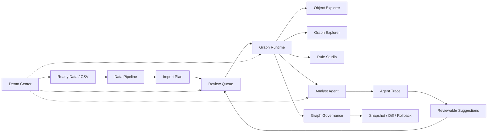

---

## Product Walkthrough

<details>
<summary>View the runtime dashboard</summary>

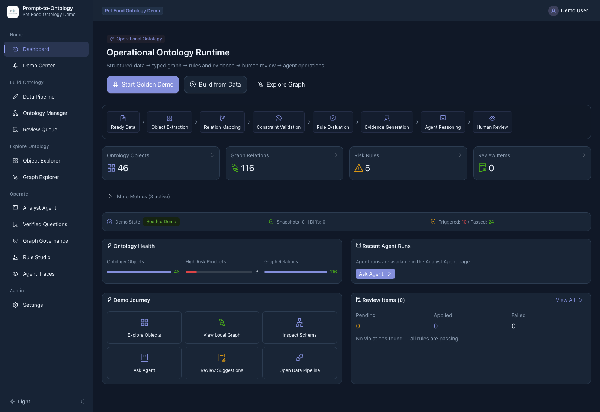

</details>

Follow the Pet Food workflow from source inspection to review, then trace PF001's first ingredient from a sample answer into the runtime graph. The screenshots and video use the same dark UI; click any image to inspect it at full size.

### 1. Profile and map a source

<table>
  <tr>
    <td width="50%" valign="top">
      <a href="media/data-profile.png">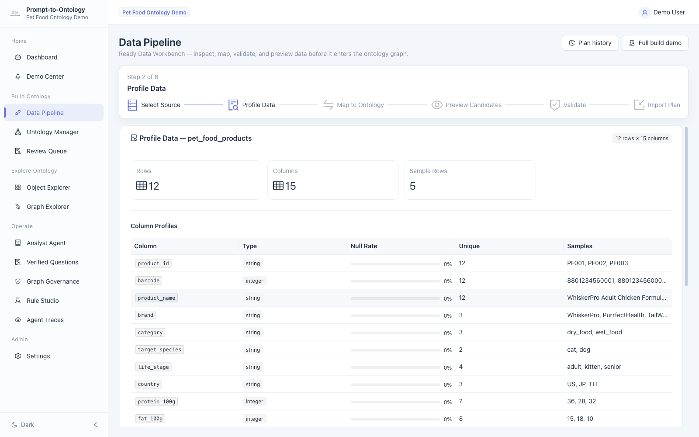</a><br>
      <strong>Profile Data</strong><br>
      Inspect the selected source in a six-step workbench. The page heading and step navigation stay visible while the step content scrolls.
    </td>
    <td width="50%" valign="top">
      <a href="media/data-pipeline.png">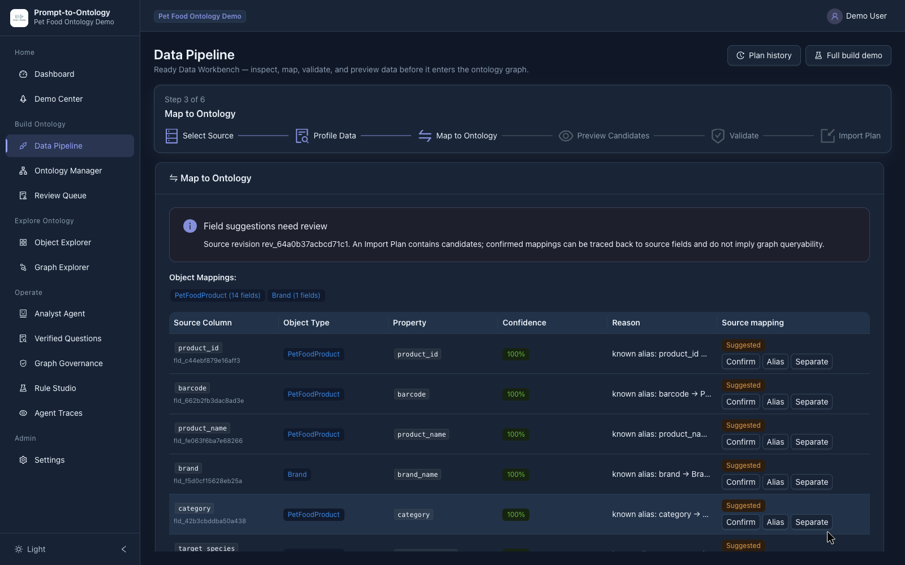</a><br>
      <strong>Map to Ontology</strong><br>
      Review field suggestions and source identity before previewing candidates, checking validation issues, and preparing an Import Plan. A confirmed mapping is not a graph write.
    </td>
  </tr>
</table>

### 2. Review candidates and inspect definitions

<table>
  <tr>
    <td width="50%" valign="top">
      <a href="media/review-queue.png">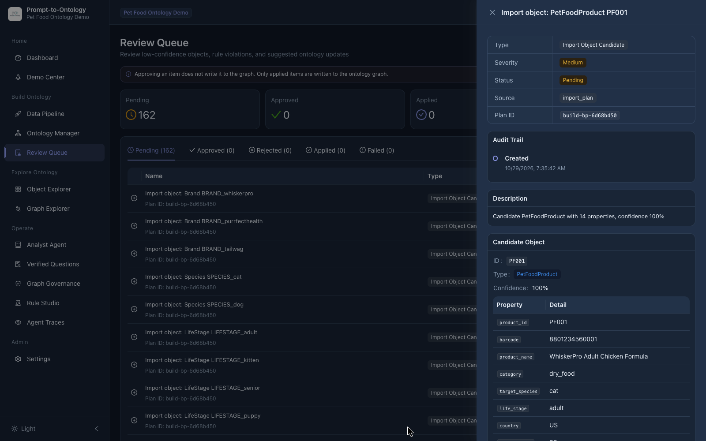</a><br>
      <strong>Review Queue</strong><br>
      Submit the optional full-build plan to inspect candidates and their audit trail. Approval and application are separate steps; this capture leaves the candidates pending.
    </td>
    <td width="50%" valign="top">
      <a href="media/ontology-manager.png">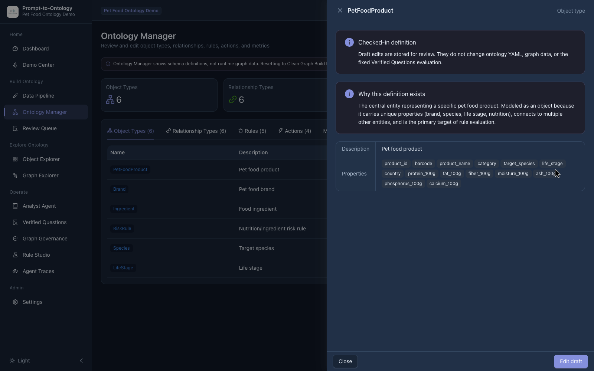</a><br>
      <strong>Ontology Manager</strong><br>
      Use the same detail-drawer interaction for types, relationships, rules, actions, and metrics. Draft edits do not change the checked-in YAML or runtime graph.
    </td>
  </tr>
</table>

### 3. Explore the runtime graph

<a href="media/graph.png">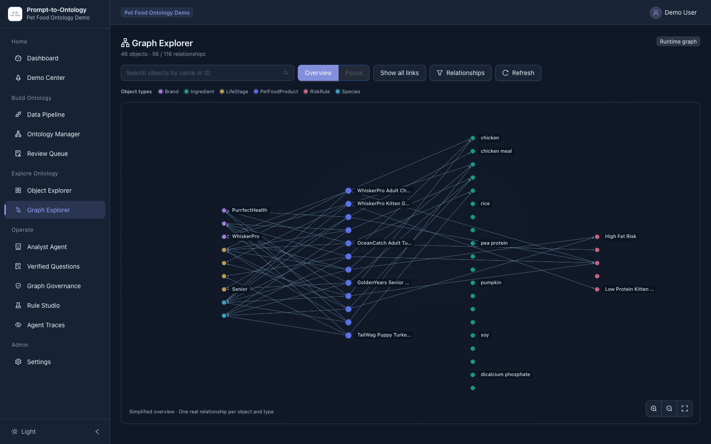</a>

Search by object name or ID, select an object, and switch between the overview and its neighborhood. The Sigma.js and Graphology view keeps every object in the overview and initially shows a subset of real relationships; **Show all links** reveals the rest. The counter makes that reduction explicit.

### 4. Follow an answer back to its evidence

<table>
  <tr>
    <td width="50%" valign="top">
      <a href="media/verified-questions.png">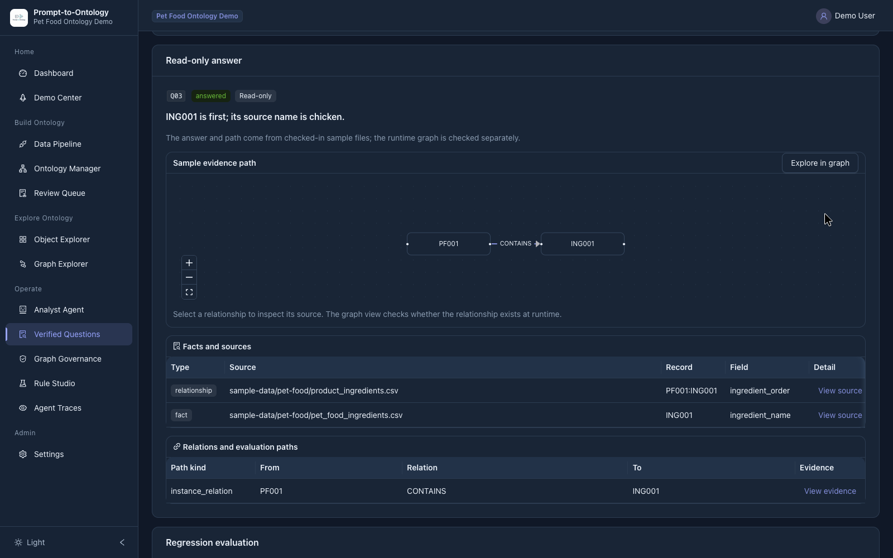</a><br>
      <strong>Verified Questions</strong><br>
      Run Q03 to see that PF001's first ingredient is ING001, named chicken. The answer, React Flow path, and source records come from the checked-in sample files.
    </td>
    <td width="50%" valign="top">
      <a href="media/graph-evidence.png">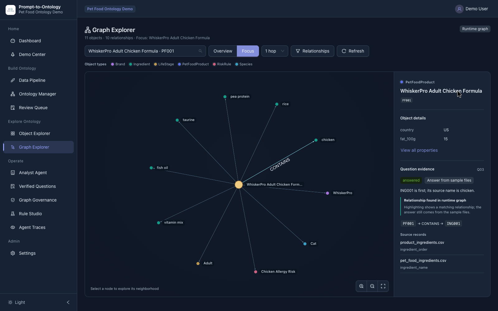</a><br>
      <strong>Explore in graph</strong><br>
      Follow the answer into PF001's neighborhood, inspect its properties, and open the cited records. The UI checks for a matching runtime relationship separately; it does not claim that Neo4j computed the sample answer.
    </td>
  </tr>
</table>

### 5. Ask the Analyst Agent

<a href="media/analyst-agent.png">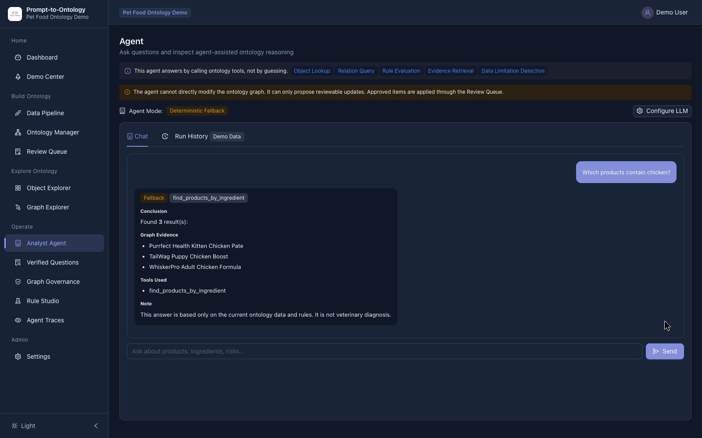</a>

This session uses **Deterministic Fallback** and the `find_products_by_ingredient` tool without an LLM key. The answer lists matching products and the tool used. Proposed updates still pass through Review Queue; heuristic trace scores are not answer-accuracy scores.

---

## Demo Notes

The recording uses the seeded Pet Food reference and applies one reviewed product. Q03 reads checked-in sample files and checks runtime relationships separately; the Agent query uses deterministic fallback mode without an LLM key. [Capture notes, chapters, and music credits](media/README.md).

---

## Quick Start

### Docker Compose (Recommended)

The app opens in dark mode by default. An explicit theme preference is preserved across visits.

```bash
git clone https://github.com/wenhaoyu-bryan/Prompt-to-Ontology.git
cd Prompt-to-Ontology
cp .env.example .env
docker compose up --build
```

| Service | URL |
|---|---|
| Frontend | http://localhost:5173 |
| Backend API | http://localhost:8765 |
| Neo4j Browser | http://localhost:7474 |

Default login: `demo` / `demo`

This login is a frontend demo affordance, **not backend authentication**. Run the stack locally on trusted networks only. The backend auto-seeds sample data on first startup unless `AUTO_SEED_DEMO_DATA=false` is set.

Docker Compose keeps the source catalog, import plans, and review state in a named `backend_runtime` volume so they survive container replacement. The explicit demo reset can clear this state.

Legacy direct-write endpoints (such as `/api/action`, `/api/pipeline/batch-import`, direct CSV import, demo reset, and snapshot restore) return HTTP 403 by default. For a disposable local demo only, set `ENABLE_LEGACY_DEMO_WRITES=true` in `.env` and restart the backend. The Review Queue API is an inspectable demo workflow, not an authorization boundary.

<details>
<summary>Manual Development</summary>

#### Prerequisites

- Docker (for Neo4j)
- Python 3.10+
- Node.js 18+

#### 1. Start Neo4j

```bash
docker run -d --name neo4j-ontology \
  -p 7474:7474 -p 7687:7687 \
  -e NEO4J_AUTH=neo4j/ \
  neo4j:5
```

#### 2. Start Backend

```bash
cd backend
pip install -r requirements.txt
uvicorn main:app --host 0.0.0.0 --port 8765 --reload
```

Pet food sample data is auto-imported on first startup.

#### 3. Start Frontend

```bash
cd frontend
npm install
npm run dev
```

Open http://localhost:5173.

</details>

---

## Guided Demo

**Dashboard → Demo Center → Start Golden Demo**

Quick Demo steps:

1. **Dashboard** — overview of runtime state
2. **Data Pipeline** — profile sample CSV, inspect source IDs, confirm mappings, generate an import plan
3. **Review Queue** — review candidates, approve or reject, apply to graph
4. **Object Explorer** — browse products, inspect evidence and risk edges
5. **Graph Explorer** — explore the local and global evidence network
6. **Rule Studio** — review rule definitions, coverage, and run simulations
7. **Analyst Agent** — ask natural-language questions, propose reviewable updates
8. **Agent Trace** — inspect structured traces and 5-score evaluations
9. **Graph Governance** — create a snapshot, view diff, test rollback

---

## Feature Matrix

| Feature | Status | Description |
|---|---|---|
| Ontology Manager | ✅ Available | Unified detail drawers for object types, link types, rules, actions, and a sample metric; persistent local edit drafts; checked-in constraints |
| Data Pipeline | ✅ Available | Profile CSV, flat JSON arrays and NDJSON; suggest and confirm field mappings, inspect source lineage, generate import plans |
| Pet Food question sets | ✅ Available | Eight-question v1 design fixture; 22-question v2 read-only answers and separate regression gold with four scored dimensions |
| Custom Object Data | ✅ Available | Upload CSV, JSON array or NDJSON with type inference |
| Relationship Data | ✅ Available | Upload CSV, JSON array or NDJSON with validation |
| Review Queue | ✅ Available | Human-in-the-loop approve / reject / apply |
| Object Explorer | ✅ Available | Browse and inspect runtime objects |
| Graph Explorer | ✅ Available | Sigma graph exploration, relationship filters, focused neighborhoods, and sample-question evidence |
| Rule Studio | ✅ Available | Rule definitions, coverage, simulation |
| Analyst Agent | ✅ Available | Tool-calling agent with deterministic fallback |
| Agent Trace and Evaluation | ✅ Available | Structured traces, 5-score evaluation |
| Graph Governance | ✅ Available | Snapshot, diff, rollback |
| Demo Center | ✅ Available | Guided step-by-step demo experience |
| Docker Compose | ✅ Available | One-command local setup |
| English and Chinese UI | ✅ Available | 400+ translation keys via i18next |

---

## LLM Configuration

The Analyst Agent works in **deterministic fallback mode** by default — no external LLM API key is required. The demo runs without any LLM configuration.

To enable LLM-powered reasoning:

1. Copy `backend/.env.example` to `backend/.env` and set your API key, **or**
2. Configure at runtime via the UI: **Settings → LLM Config**

**Supported providers:** OpenAI, Anthropic, MiniMax

> Never commit `.env` files. They are already in `.gitignore`.

---

## Tech Stack

| Layer | Technology |
|---|---|
| Frontend | React 18, Vite 6, Refine, Ant Design 6, React Router v6, i18next, Sigma.js, Graphology, React Flow, D3.js, Playwright |
| Backend | FastAPI, Neo4j 5, NetworkX, YAML schema, 4-state rule engine, tool-calling agent with deterministic fallback |
| Runtime | Docker Compose |

---

## Repository Structure

```
backend/
  ontology_kernel/     Schema-driven runtime and validation
  data_pipeline/       CSV profiling, mapping, import plans
                       Persistent source revision and mapping catalog
  review_queue/        HITL review workflow
  graph_snapshot/      Snapshot, diff, rollback
  rule_studio/         Rule definitions and simulation
  agent_trace/         Trace and evaluation
  scenario_run/        Guided demo orchestration
frontend/
  pages/               Dashboard, Graph, Agent, Rule Studio, Demo Center, ...
  components/          Layout, navigation
  i18n/                English + Chinese (400+ keys)
  tests/smoke/         Playwright route smoke tests
docs/                  Product docs, architecture, demo scripts
media/                 Screenshots and demo video
ontology/pet_food/     Pet Food domain schema (YAML)
sample-data/           Demo CSV data
  pet-food/question-set.v1.json  Fixed Pet Food question baseline
```

---

## Testing

Backend: run module checks from `backend/` with `python scripts/test_<module>.py`. Run the focused unit tests from the repository root with `PYTHONPATH=backend python -m unittest discover -s backend/tests`.

Frontend: `npm run test:smoke -- --workers=1` (Playwright route, responsive, and Pet Food workflow checks). Start the local Docker Compose stack first.

GitHub Actions runs backend unit/module checks, Neo4j integration checks, a frontend build, and Playwright UI smoke tests on pull requests and pushes to `main`. The browser job starts a disposable Docker Compose stack. The protected `main` branch requires all four checks. CI does not deploy the project.

---

## Project Status

Prompt-to-Ontology is a learning project with a runnable reference implementation. The included Pet Food demo makes the design choices and workflow inspectable.

The repository includes backend checks and frontend smoke tests, but does not provide a production deployment, enterprise identity and access management, or validation across multiple business domains. Source mapping decisions are persisted as metadata; they do not prove that an imported value is queryable in Neo4j. Verified Questions read checked-in CSV/YAML sample files rather than the runtime Neo4j graph. Graph Explorer can highlight matching runtime relationships for a sample answer, but that match does not establish that the answer was computed from Neo4j. A separate schema graph view remains future work.

Ontology Manager edits are saved as local review drafts in `backend/.runtime/schema_drafts.json` (a persistent Docker volume when using Compose). They survive page refreshes and can be discarded from the detail drawer. Active ontology behavior continues to use the checked-in YAML until a reviewed code change updates it.

## Contributing

Small, focused contributions are welcome, especially documentation improvements, reproducible bug reports, and tests. Read the [contribution guide](CONTRIBUTING.md) for setup, local checks, PR requirements, and release-impact choices. For larger feature ideas, open an issue first to check that they fit the project's learning scope.

---

## Disclaimer

This demo does not provide veterinary diagnosis. Risk explanations are based only on the current ontology data and demo rules. If data is missing, the system reports that the rule cannot be evaluated rather than claiming the product is safe.

---

## License

MIT

---

<p align="center">
  <sub>A learning-by-building reference for operational ontologies: structured data → typed graph → rules and evidence → human review → ontology-grounded agent.</sub>
</p>
