# 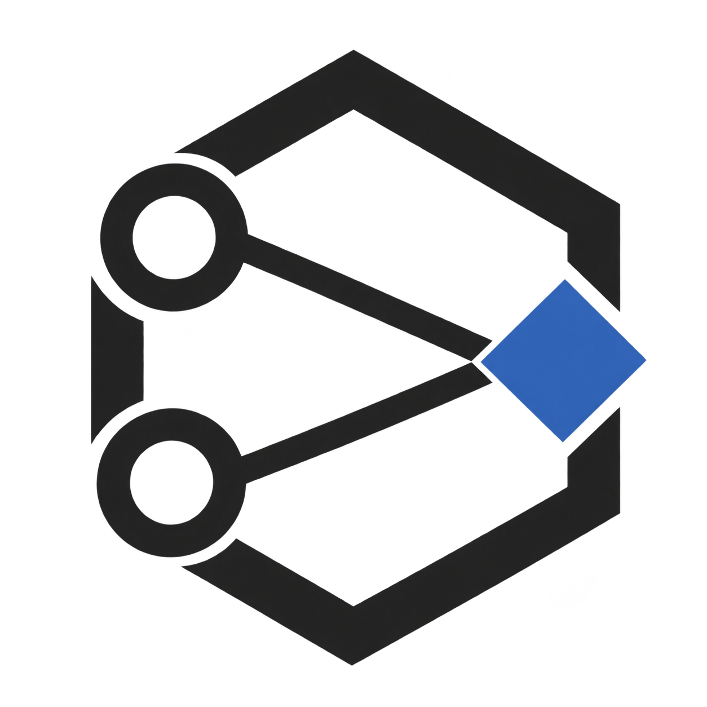 Prompt-to-Ontology

Design ontology definitions, map source data, and review changes before they reach the graph.

[](https://github.com/wenhaoyu-bryan/Prompt-to-Ontology/releases/latest)
[](https://github.com/wenhaoyu-bryan/Prompt-to-Ontology/actions/workflows/ci.yml)
[](LICENSE)

https://github.com/user-attachments/assets/0e0b9ad5-71e1-483a-8989-9ebf2512f713

**103-second workflow demo · light theme · DeepSeek** · [Download MP4](https://github.com/wenhaoyu-bryan/Prompt-to-Ontology/releases/download/v0.6.0/prompt-to-ontology-v0.6.0-demo.mp4) · [中文](README.zh-CN.md)

Recorded on 2026-11-02. See [recording provenance](media/README.md) for the captured version and workflow; the badge above tracks the latest software release.

Prompt-to-Ontology is an open-source ontology workbench for connecting source data, typed objects, explicit rules, human review, and ontology-grounded Agents. Its workspace separates schema design from runtime data import and query. The bundled Pet Food domain provides data, rules, and evaluation cases for a runnable reference workflow; you can also design definitions for your own domain.

- **Design definitions.** Start from CSV/JSON/NDJSON files or PostgreSQL/MySQL DDL. Review proposed objects, properties, relationships, and their sources, then export the design or save definitions to Ontology Manager.
- **Build with assistance.** Describe an import goal and upload data files. Review mappings into the configured runtime schema, resolve pending decisions, and preview candidate objects and relationships.
- **Review before applying.** Inspect proposed changes in an Import Plan and Review Queue, then approve and apply them to the graph.
- **Inspect the evidence.** Follow sample answers through relationship paths, open cited source records, and check for matching runtime relationships.
- **Evaluate Agent runs.** Edit evaluation questions, inspect actual answers and tool results, compare runs, and turn feedback into regression cases.

## Quick start

Install Git and Docker with Docker Compose v2, then run:

```bash
git clone https://github.com/wenhaoyu-bryan/Prompt-to-Ontology.git
cd Prompt-to-Ontology
cp .env.example .env
docker compose up --build
```

Open **http://localhost:5173** and sign in with **`demo` / `demo`**.

The backend seeds sample data on first startup by default. You can try the Analyst Agent in deterministic fallback mode **without an external LLM API key**.

| Service | Address |
| --- | --- |
| Application | http://localhost:5173 |
| Backend API | http://localhost:8765 |
| Neo4j Browser | http://localhost:7474 |

Run the stack locally on a trusted network. The demo login is a frontend convenience, not backend authentication.

For setup and troubleshooting, see [Local Docker setup](docs/local-docker-setup.md). In **Model configuration**, save an **OpenAI Chat Completions-compatible** or **Anthropic Messages** connection and bind models separately to **Build** and **Query**. Keys stay on the backend and persist in Docker's runtime volume; environment variables can supply deployment defaults. Without a usable model, the deterministic baseline remains available. It uses known schema aliases and keys rather than interpreting arbitrary goals. See [model setup](docs/question-set-evaluation.md#model-setup).

<details>
<summary>Sample data, persistence, and demo write settings</summary>

- Set `AUTO_SEED_DEMO_DATA=false` in `.env` to disable automatic sample seeding.
- Compose stores source data, import plans, review state, and saved model connections in the `backend_runtime` volume. These survive container replacement. A demo reset clears workflow data; deleting the volume also deletes saved model settings.
- Direct demo-write operations, including demo reset and snapshot restore, return HTTP 403 by default. Enable `ENABLE_LEGACY_DEMO_WRITES=true` only for a disposable local demo, then restart the backend. Use **Import Plan → Review Queue** for the regular build workflow.
- Review Queue demonstrates review decisions and graph application; it is not an authorization boundary.

</details>

## Supported sources

| Source | Instance import | Schema design | How it is used |
| --- | --- | --- | --- |
| CSV, flat JSON arrays, NDJSON (`.ndjson` / `.jsonl`) | Yes | Yes | Rows and columns support profiling, mappings, and definition proposals. |
| Excel (`.xlsx`) | Yes | Not yet | Choose one worksheet and its header row, preview the rows, then import. |
| PostgreSQL / MySQL DDL (`.sql`, `.ddl`) | No | Yes | Parse declared tables and keys locally; this does not connect to a live database. |
| Markdown (`.md`) product documents / SOPs | No | With DDL + Build Agent | Add semantic context with citations to exact original lines; documents are not standalone import sources. |

<details>
<summary>Input limits and preparation</summary>

- Public HTTP uploads accept up to **8 files**, at most **2 MB each** and **8 MiB total**. JSON records must be flat, use consistent columns, and contain no nested objects or arrays.
- XLSX import uses one worksheet per workbook. Formula and error cells are rejected; use values-only sheets and store identifiers with leading zeroes as text.
- A DDL design accepts one `.sql` or `.ddl` file (up to 256 KiB and 32 tables), without tabular uploads in the same task. Only the documented DDL subset is parsed.
- Attach up to **3 UTF-8 Markdown references** to a DDL design with Build Agent: 12 KiB per file, 24 KiB and 600 lines total. The configured provider receives the reference text.

See [Assisted build and schema design](docs/assisted-build.md) for supported syntax and full limits.

</details>

## Build workflows

### Import into an existing schema

1. Open **Data Pipeline → Import data**, add source files, and describe the import goal.
2. The assistant proposes mappings into the configured runtime schema, including object types, identity fields, and relationship endpoints.
3. Resolve pending decisions, select **Confirm mappings & preview**, and inspect the candidate values and changes.
4. Submit the reviewed preview to **Review Queue**. Inspect each candidate, then **approve** and **apply** as separate actions.
5. Return to **Check runtime graph** to verify objects, properties, and relationships in Neo4j.

**Manual configuration** also provides the six-stage import workflow.

### Design new definitions

1. Open **Data Pipeline → Design schema draft** and supply CSV/JSON/NDJSON files or DDL.
2. Deterministic analysis establishes the source structure. An optional Build Agent adds semantic suggestions.
3. Review definitions and source bindings, resolve choices, inspect the definition diff, and save.
4. Export the design package or choose **Save definitions to Manager**.
5. Continue in **Ontology Manager**: edit objects, properties, and relationships in one drawer. Use **View source** for provenance or **Type map** to open definitions from a graph.

**Saving a design or Manager catalog does not activate a runtime schema.** Import and query still use the configured YAML definitions. See [Assisted build and schema design](docs/assisted-build.md) for the handoff boundary.

For DDL, the model can suggest display labels, descriptions, and cited review notes. Parsed declarations determine technical identifiers, types, keys, bindings, and relationships. Product documents and SOPs can support reviewable term or rule candidates; they do not become executable rules. The flow neither invents nor executes arbitrary SQL.

To explore the reference, run **Evaluation & feedback → Reference tests · 22 → Q03: What is PF001's first ingredient?** Inspect the `CONTAINS` path and cited records, then select **Explore in graph**. Ask the **Analyst Agent** “Which products contain chicken?” to inspect runtime tool calls and relationship paths. In **Evaluation & feedback**, compare Agent runs, review answers that need judgment, and turn query feedback into editable cases.

The reference also includes object and graph exploration, four-state rule evaluation, agent traces, and graph snapshots, diffs, and rollback. Use **Demo Center → Start Golden Demo** for the guided tour.

<details>
<summary>View the v0.6.0 workflow screenshots</summary>

### Runtime overview

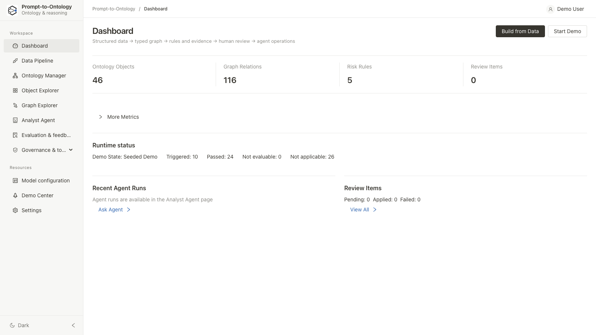

### Assisted build

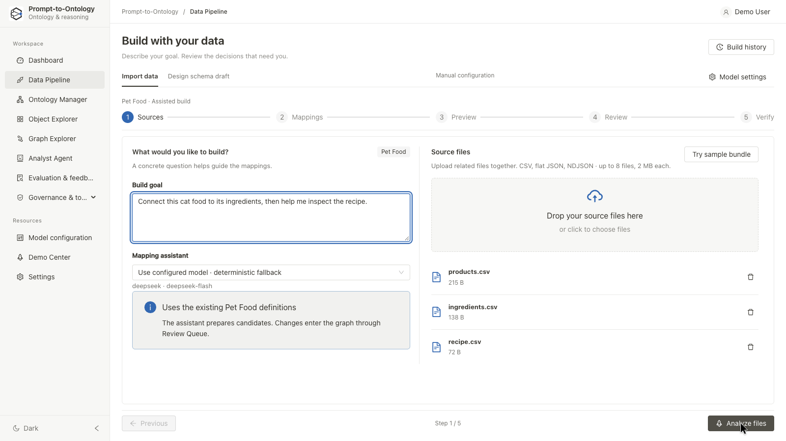

### Source mapping

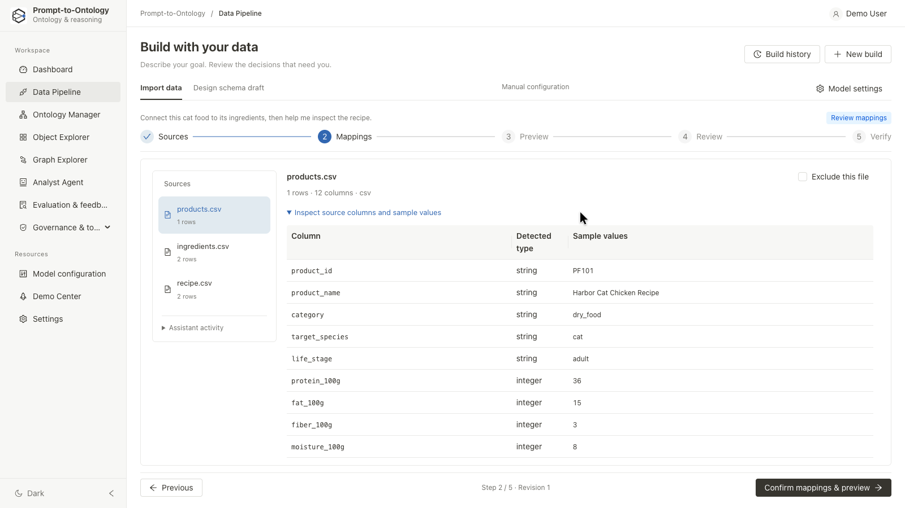

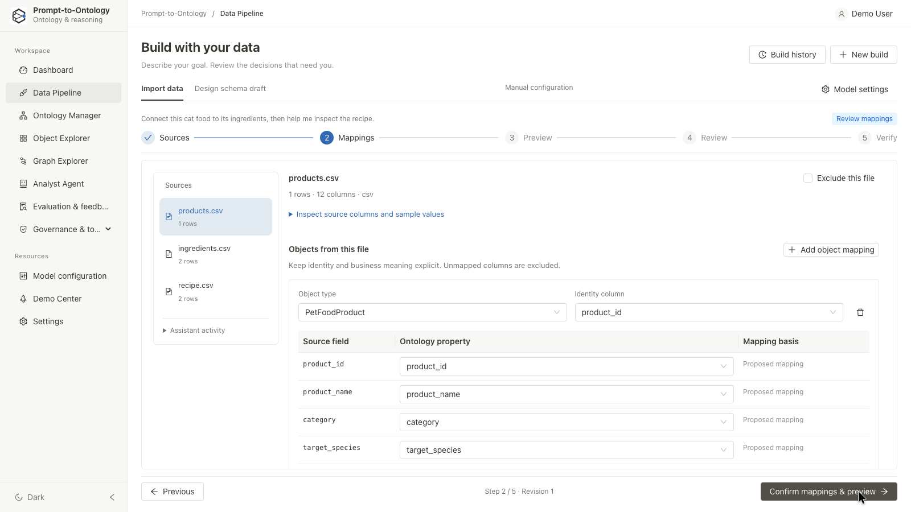

Confirm mappings before preparing candidates. A confirmed mapping records a decision; it does not prove that data is queryable in Neo4j.

### Change review

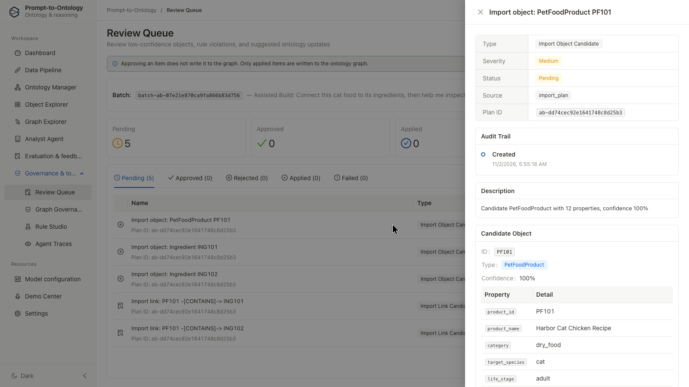

Inspect a candidate before approval. The recording adds PF101, two ingredients, and two `CONTAINS` relationships to an already seeded graph. All five changes are reviewed and applied; this is not a full rebuild from an empty graph.

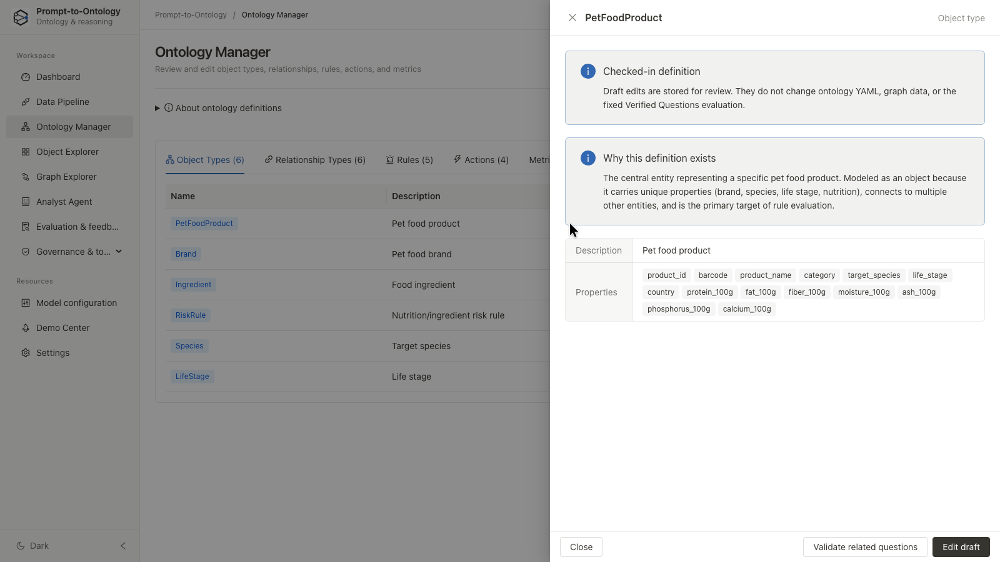

This v0.6.0 capture predates the current Manager catalog and unified definition drawer.

### Graph exploration

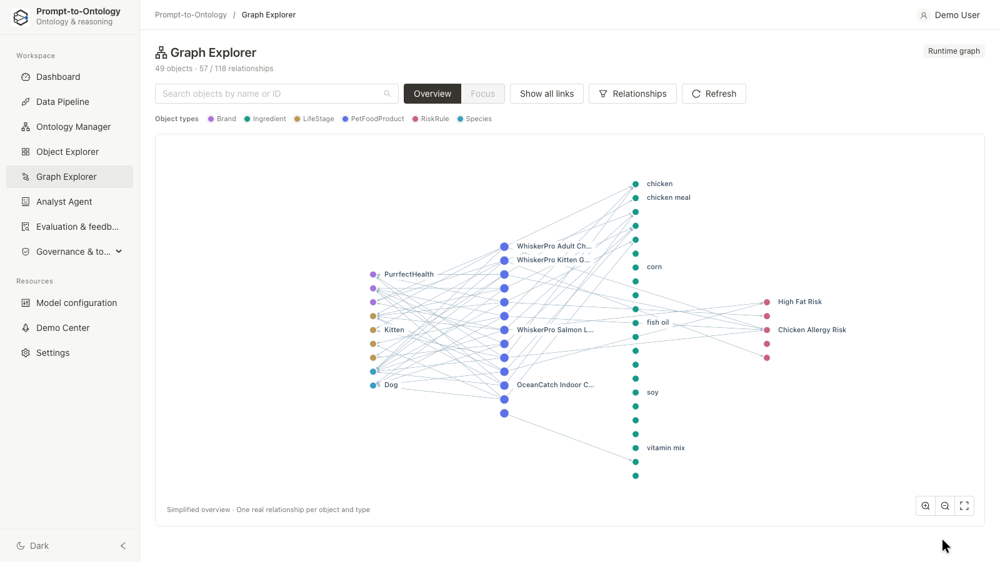

Search for an object, inspect its neighborhood, or expand the overview's relationship display.

### Answer evidence

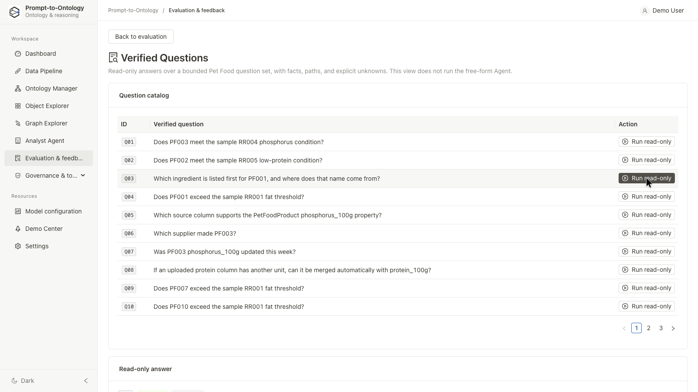

The fixed Q03 answer reads checked-in sample files. Graph Explorer separately checks whether the corresponding relationship exists in the runtime graph.

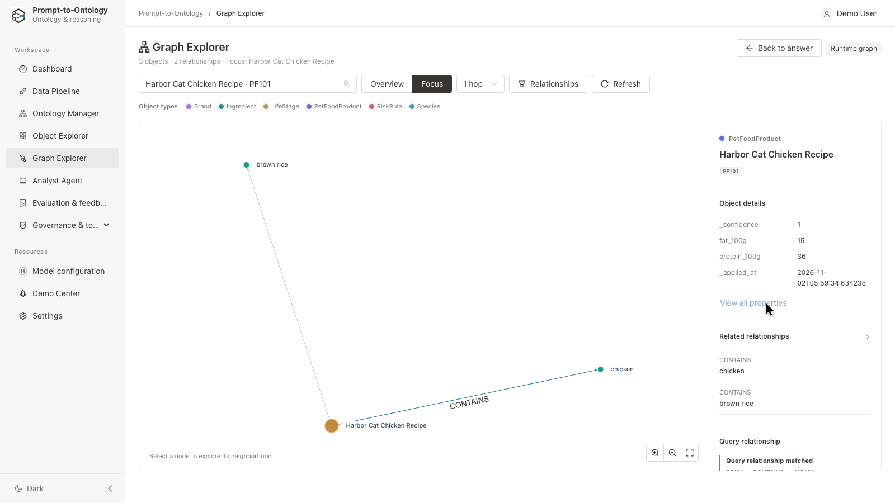

### Analyst Agent

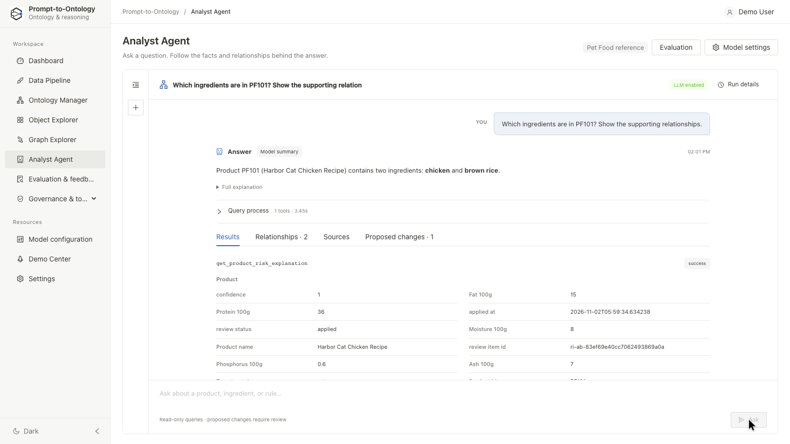

The recording uses DeepSeek for the build proposal and for query planning and answer summarization. It shows recorded tool calls and checks the returned relationship in the runtime graph.

</details>

The video and screenshots are earlier v0.6.0 light-workspace captures, preserved as a walkthrough of assisted import, human review, runtime verification, and a live model query. Current schema design, source support, and Manager editing extend beyond these captures. See [Assisted build](docs/assisted-build.md), [Query Workbench](docs/query-workbench.md), and [Evaluation & feedback](docs/question-set-evaluation.md) for current flows.

[Product workflow](docs/product-workflow.md) · [Recording notes and additional captures](media/README.md)

## Scope and evaluation

This repository is a learning reference. Production readiness, enterprise identity and access management, and applicability across multiple business domains have not been established.

- **Reference answers and Agent queries use different evidence.** Reference tests read checked-in CSV/YAML files; graph highlighting checks for matching runtime relationships. Agent queries use runtime tools. Their returned evidence strings are not original file-row or document citations.
- **Evaluation scores cover configured checks.** Agent evaluation records actual answers, tools, and traces. Scores reflect the configured checks, with separate manual review where needed. They do not establish general Agent accuracy. The video uses a configured DeepSeek model; the key is not included in the recording or repository.
- **Catalog definitions and runtime definitions are separate.** Ontology Manager saves reviewed definitions and their source provenance in the design catalog. Import and query continue to use the configured YAML schema until a separate integration changes it.
- **Rules describe the sample.** Results reflect the available data and configured conditions, not veterinary advice. Missing evidence can make a rule not evaluable.

<details>
<summary>Modeling approach and fixed-question evaluation</summary>

The prompt establishes a decision question and a modeling hypothesis. The workflow then:

1. Profiles source fields, missing values, and source revisions.
2. Proposes object, property, and relationship mappings for human review.
3. Defines types, constraints, rules, and action contracts in YAML.
4. Generates candidate changes through an Import Plan.
5. Reviews and applies candidates, then inspects results and evidence.

The [eight-question v1 set](sample-data/pet-food/question-set.v1.json) is a design baseline with hashed source inputs. The [22-question v2 catalog](sample-data/pet-food/verified-questions.v2.json) supplies bounded read-only query plans. Separate [reference judgments](sample-data/pet-food/verified-gold.v2.json) are read only by the regression evaluator.

Regression evaluation scores conclusion, source evidence, evaluation path, and appropriate abstention separately. It supports rerunning questions affected by changed assets, comparing runs per question, and saving proposed questions as drafts. These checks evaluate the fixed sample reader, not general Agent reliability.

</details>

## Documentation

| Guide | Contents |
| --- | --- |
| [Documentation index](docs/README.md) | Product, architecture, and development guides |
| [Assisted build and schema design](docs/assisted-build.md) | Source support, Agent workflows, DDL/document assistance, and Manager handoff |
| [Data pipeline](docs/data-pipeline.md) | Manual source profiling, mapping, and import plans |
| [Review Queue](docs/review-queue-runtime.md) | Review decisions and graph application |
| [Ontology kernel](docs/ontology-kernel.md) | Schema definitions and validation |
| [Query Workbench](docs/query-workbench.md) | Conversations, runtime tools, relationship paths, and feedback |
| [Evaluation & feedback](docs/question-set-evaluation.md) | Model setup, editable cases, run comparison, and manual review |
| [Analyst Agent](docs/agent-operator.md) | Ontology tools and reviewable suggestions |
| [Agent traces and evaluation](docs/agent-trace-evaluation.md) | Trace inspection and evaluation methods |
| [Graph governance](docs/graph-snapshot-diff-rollback.md) | Snapshots, diffs, and rollback |

**Stack:** React · FastAPI · Neo4j · Sigma.js / Graphology · React Flow · Docker Compose. The application supports English and Chinese.

## Development

Backend unit tests, from the repository root:

```bash
PYTHONPATH=backend python -m unittest discover -s backend/tests
```

Frontend build, from `frontend/`:

```bash
npm ci
npm run build
```

With the local Compose stack running, run `npm run test:smoke -- --workers=1` from `frontend/` for Playwright checks. GitHub Actions also runs backend module and Neo4j integration checks. CI does not deploy the project.

See [Contributing](CONTRIBUTING.md) for development requirements and [Release process](docs/releasing.md) for versioning and publication.

## Design references

The project learns from publicly documented [Palantir Foundry Ontology concepts](https://www.palantir.com/docs/foundry/ontologies/ontologies-overview) and [Semantica](https://github.com/semantica-agi/semantica). These are design references, not claims of access to vendor internals or feature equivalence.

Graph Explorer's layout and exploration interactions are inspired by Semantica's Knowledge Explorer. This project uses Sigma.js and Graphology for the graph view, and React Flow for answer paths.

## Contributing

Reproducible bug reports, documentation improvements, and focused tests are welcome. For larger changes, open an issue to discuss the scope first.

Read the [contribution guide](CONTRIBUTING.md) before submitting a pull request.

## License

[MIT](LICENSE). Third-party media retains its own license; see [music credits](media/README.md#music-credit).
