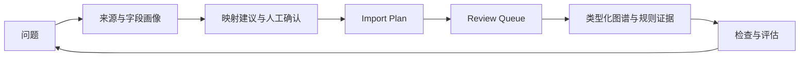

# Prompt-to-Ontology

[](https://github.com/wenhaoyu-bryan/Prompt-to-Ontology/actions/workflows/ci.yml)

**[English](README.md) | 中文**

> 用一个可运行的 Pet Food 参考实现，研究如何从问题与原始数据出发，构建可检查、可追溯、可审核的业务本体。

**项目状态：学习项目 · 可运行参考实现 · 单一 Pet Food 样例**

当前版本线为 `0.x`。每个功能 PR 都需说明对发版的影响（无需发版、补丁或次版本）；版本文件统一更新后，只从通过 CI 的 `main` 创建 Tag。详见[版本决策与发版流程](docs/releasing.md)。


## 项目定位

本仓库展示从 CSV 到类型化对象、关系、规则证据和 Review Queue 的构建过程。它用于检验产品与架构设计，不代表企业平台能力、跨领域通用性或生产就绪。Pet Food 是唯一的主示例；规则结果仅说明样例数据是否满足仓库里的配置条件，不能当作兽医建议。

设计参考包括公开的 [Palantir Foundry Ontology 文档](https://www.palantir.com/docs/foundry/ontologies/ontologies-overview) 和开源 [Semantica](https://github.com/semantica-agi/semantica)。本项目是独立的学习实践，不声称与它们的功能等价，也不包含公司内部资料。

## 核心构建思路：Prompt 是问题起点

这里的 Prompt 不等于“一句话自动生成最终图谱”。它首先提出需要回答的业务问题与建模假设，再通过以下闭环逐步验证：

1. **定义问题**：明确要判断或解释什么，例如“某个样例产品是否满足一条已配置规则”。
2. **盘点证据**：记录 CSV 来源、字段、空值与内容版本；缺少供应商或时间字段时，明确标记无法回答。
3. **提出语义映射**：将字段建议映射到对象、属性、关系。建议不自动等于确认；可确认一致、标记别名，或保持独立。
4. **定义可执行规则**：用 Pet Food YAML Schema 声明类型、约束和规则，让结果附带可检查的依据。
5. **审核后应用**：由 Import Plan 生成候选对象与关系，经 Review Queue 审核后写入图谱。
6. **检查与迭代**：浏览图谱、规则证据和 Agent Trace，针对无答案或冲突修正来源映射和 Schema。

[Pet Food 八个固定问题](sample-data/pet-food/question-set.v1.json)覆盖规则触发、未触发、关系来源、字段来源、数据缺口及冲突处理，并使用 SHA-256 固定 CSV 与规则输入。这是可复现的设计及后续评估基线，**尚不是 Agent 正确率报告**。



## 已实现与边界

| 能力 | 当前状态 |
|---|---|
| Pet Food CSV 画像、映射建议、Import Plan | 可运行 |
| 来源资产 ID、内容版本 ID、字段 ID、映射决定与双向追溯 | 可运行；来源目录只存元数据和决定。Import Plan 仍可能保存来源画像中的样例行 |
| Review Queue 审核及应用 | 可运行的演示工作流；并非后端权限系统 |
| 对象、图谱、规则、Agent、Trace、快照与回滚 | 可在样例中检查；Agent Trace 的启发式分数不等于答案正确率 |
| 八个固定问题 | 有事实与来源检查；尚未自动跑 Agent 答案评估 |
| 其他行业、生产权限、性能与稳定性 | 未验证 |

来源状态需区分：**已解析、建议映射、人工确认、图谱可查询**。确认字段映射并不证明数据已经写入 Neo4j；生成 Import Plan 也只产生候选。

## 本地运行

```bash
git clone https://github.com/wenhaoyu-bryan/Prompt-to-Ontology.git
cd Prompt-to-Ontology
cp .env.example .env
docker compose up --build
```

前端：<http://localhost:5173>；API：<http://localhost:8765>；Neo4j Browser：<http://localhost:7474>。前端演示登录为 `demo` / `demo`，**不是后端身份认证**。请在可信的本地网络运行。首次启动默认自动导入 Pet Food 样例；可设置 `AUTO_SEED_DEMO_DATA=false` 关闭自动导入。

Compose 使用命名卷 `backend_runtime` 保存来源目录、Import Plan 和审核状态，容器重建后仍可读取；执行明确的演示重置会清理这些状态。

旧版直接写入接口（如 `/api/action`、`/api/pipeline/batch-import`、直接 CSV 导入、演示重置、快照恢复）默认返回 HTTP 403。只有在可丢弃的本地演示中才在 `.env` 设置 `ENABLE_LEGACY_DEMO_WRITES=true` 并重启后端。常规构建路径请使用 Import Plan → Review Queue。Review Queue 本身不是权限边界。

无需 LLM 密钥即可使用确定性回退模式。需要外部模型时，可通过 Settings → LLM Config 配置；不要提交 `.env`。

## 推荐体验路径

Dashboard → Data Pipeline（选择样例、检查来源 ID、确认字段、生成 Import Plan）→ Review Queue → Object Explorer → Graph Explorer → Rule Studio → Analyst Agent → Agent Trace → Graph Governance。

图谱视图当前用于浏览运行时对象与关系。按 Schema 结构与运行时实例分层、显示来源及证据的视觉升级尚未纳入此阶段，见英文 README 的后续方向。

## 测试

在仓库根目录运行新增单元测试：

```bash
PYTHONPATH=backend python -m unittest discover -s backend/tests
```

在 `backend/` 运行已有 `python scripts/test_<module>.py` 模块检查；前端在 `frontend/` 运行 `npm run build`，本地可运行 `npm run test:smoke`。GitHub Actions 在 PR 中运行后端模块检查、Neo4j 集成检查与前端构建；Playwright smoke tests 尚未纳入 CI。

## 许可

MIT
