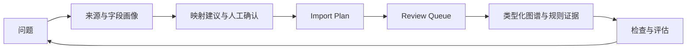

# Prompt-to-Ontology

https://github.com/user-attachments/assets/97bf16a6-b8e2-4364-af25-73ef42201fea

**1:36 · 1080p · 产品录屏与配乐** · [下载 MP4](https://github.com/wenhaoyu-bryan/Prompt-to-Ontology/releases/download/v0.3.1/prompt-to-ontology-product-demo.mp4) · [English](README.md)

图谱探索 → 数据映射 → 人工审核 → 问答证据追溯。实际产品录屏，配乐与英文画面提示。

[](https://github.com/wenhaoyu-bryan/Prompt-to-Ontology/actions/workflows/ci.yml)

**[English](README.md) | 中文**

[贡献指南](CONTRIBUTING.zh-CN.md) · [发版流程](docs/releasing.md)

> 用一个可运行的 Pet Food 参考实现，研究如何从问题与原始数据出发，构建可检查、可追溯、可审核的业务本体。

**项目状态：学习项目 · 可运行参考实现 · 单一 Pet Food 样例**

## 项目定位

本仓库展示从 CSV 到类型化对象、关系、规则证据和 Review Queue 的构建过程。它用于检验产品与架构设计，不代表企业平台能力、跨领域通用性或生产就绪。Pet Food 是唯一的主示例；规则结果仅说明样例数据是否满足仓库里的配置条件，不能当作兽医建议。

设计参考包括公开的 [Palantir Foundry Ontology 文档](https://www.palantir.com/docs/foundry/ontologies/ontologies-overview) 和开源 [Semantica](https://github.com/semantica-agi/semantica)。本项目是独立的学习实践，不声称与它们的功能等价，也不包含公司内部资料。

Graph Explorer 的视觉布局和探索交互参考了 Semantica 的 Knowledge Explorer。本项目使用 Sigma.js 和 Graphology 实现图谱视图，并使用 React Flow 展示问答证据路径。

## 核心构建思路：Prompt 是问题起点

这里的 Prompt 不等于“一句话自动生成最终图谱”。它首先提出需要回答的业务问题与建模假设，再通过以下闭环逐步验证：

1. **定义问题**：明确要判断或解释什么，例如“某个样例产品是否满足一条已配置规则”。
2. **盘点证据**：记录 CSV 来源、字段、空值与内容版本；缺少供应商或时间字段时，明确标记无法回答。
3. **提出语义映射**：将字段建议映射到对象、属性、关系。建议不自动等于确认；可确认一致、标记别名，或保持独立。
4. **定义可执行规则**：用 Pet Food YAML Schema 声明类型、约束和规则，让结果附带可检查的依据。
5. **审核后应用**：由 Import Plan 生成候选对象与关系，经 Review Queue 审核后写入图谱。
6. **检查与迭代**：浏览图谱、规则证据和 Agent Trace，针对无答案或冲突修正来源映射和 Schema。

[Pet Food 八个固定问题](sample-data/pet-food/question-set.v1.json)覆盖规则触发、未触发、关系来源、字段来源、数据缺口及冲突处理，并使用 SHA-256 固定 CSV 与规则输入。这是可复现的设计及后续评估基线，**尚不是 Agent 正确率报告**。

新增的 [22 题可核对问题集](sample-data/pet-food/verified-questions.v2.json)提供固定范围内的只读回答，逐条展示来源、路径和无法回答的原因。[参考答案](sample-data/pet-food/verified-gold.v2.json)仅由回归评估器读取；结论、证据、路径、恰当弃答分别评分。支持按变更资产重跑受影响问题、逐题比较两轮结果，以及把新增问题建议保存为待审草稿。这些分数只代表样例问题集和确定性读取器，**不是自由文本 Agent 的正确率**。



## 产品体验图解

<details>
<summary>查看运行概览 Dashboard</summary>


</details>

以下截图来自当前 Pet Food 本地演示会话，沿着来源检查、候选审核、图谱探索与证据追溯展开。截图和视频统一使用深色界面，点击图片可查看原图。

### 1. 分步检查来源与字段映射

<table>
  <tr>
    <td width="50%" valign="top">
      <a href="media/data-profile.png"></a><br>
      <strong>数据画像</strong><br>
      六步工作台每次展示一个阶段，标题与步骤导航保持可见，下方内容独立滚动。
    </td>
    <td width="50%" valign="top">
      <a href="media/data-pipeline.png"></a><br>
      <strong>语义映射</strong><br>
      检查来源版本与字段建议，再预览候选、查看校验问题并生成 Import Plan。确认映射不等于写入图谱。
    </td>
  </tr>
</table>

### 2. 审核候选与检查本体定义

<table>
  <tr>
    <td width="50%" valign="top">
      <a href="media/review-queue.png"></a><br>
      <strong>Review Queue</strong><br>
      提交可选的完整构建计划后，在详情抽屉检查候选与审核记录。批准和应用是两步；截图中的候选仍处于待审状态。
    </td>
    <td width="50%" valign="top">
      <a href="media/ontology-manager.png"></a><br>
      <strong>Ontology Manager</strong><br>
      类型、关系、规则、Action 和指标统一通过详情抽屉查看与编辑草稿。草稿不会修改仓库 YAML 或运行时图谱。
    </td>
  </tr>
</table>

### 3. 探索运行时图谱

<a href="media/graph.png"></a>

Sigma.js 与 Graphology 图谱支持按名称或 ID 搜索、选择对象、切换总览与局部邻域。总览保留全部对象，默认仅展示部分真实关系，并明确显示当前关系数与总数；点击 **Show all links** 可展开全部关系。

### 4. 从问题追溯到证据

<table>
  <tr>
    <td width="50%" valign="top">
      <a href="media/verified-questions.png"></a><br>
      <strong>固定问题与证据路径</strong><br>
      运行 Q03，查看 PF001 的首位成分 ING001（chicken）。答案、React Flow 路径和引用记录来自仓库中的样例文件。
    </td>
    <td width="50%" valign="top">
      <a href="media/graph-evidence.png"></a><br>
      <strong>跳入图谱核对</strong><br>
      从答案进入 PF001 邻域，查看属性与来源记录。界面单独核对运行时关系是否匹配；这不表示样例答案由 Neo4j 计算得出。
    </td>
  </tr>
</table>

### 5. 使用 Analyst Agent

<a href="media/analyst-agent.png"></a>

本轮使用无需 LLM 密钥的 **Deterministic Fallback** 模式，通过 `find_products_by_ingredient` 工具列出含鸡肉的产品，并展示工具名称。修改建议仍需进入 Review Queue；Trace 的启发式分数不等于答案正确率。

## 演示说明

视频使用已载入样例数据的图谱，演示单个产品的审核与应用。Q03 答案读取仓库内的样例文件，再单独检查运行时关系；Agent 查询使用无需 LLM 密钥的确定性演示模式。[录制说明、章节与配乐署名](media/README.md)。

## 已实现与边界

| 能力 | 当前状态 |
|---|---|
| Pet Food CSV、扁平 JSON 数组、NDJSON 画像、映射建议、Import Plan | 可运行 |
| 来源资产 ID、内容版本 ID、字段 ID、映射决定与双向追溯 | 可运行；来源目录只存元数据和决定。Import Plan 仍可能保存来源画像中的样例行 |
| Review Queue 审核及应用 | 可运行的演示工作流；并非后端权限系统 |
| 对象、图谱、规则、Agent、Trace、快照与回滚 | 可在样例中检查；Agent Trace 的启发式分数不等于答案正确率 |
| 固定问题与回归评估 | v1 八题为设计基线；v2 22 题可只读回答，四项独立评分与逐题对比可运行 |
| 指标与 Action 契约 | 样例指标可回答猫粮数量问题；Action 声明适用对象、输入、前置条件、结果、副作用与审批要求，不执行外部写入 |
| 其他行业、生产权限、性能与稳定性 | 未验证 |

来源状态需区分：**已解析、建议映射、人工确认、图谱可查询**。确认字段映射并不证明数据已经写入 Neo4j；生成 Import Plan 也只产生候选。

## 本地运行

界面默认使用深色，已明确设置的主题偏好会在下次访问时保留。

```bash
git clone https://github.com/wenhaoyu-bryan/Prompt-to-Ontology.git
cd Prompt-to-Ontology
cp .env.example .env
docker compose up --build
```

前端：<http://localhost:5173>；API：<http://localhost:8765>；Neo4j Browser：<http://localhost:7474>。前端演示登录为 `demo` / `demo`，**不是后端身份认证**。请在可信的本地网络运行。首次启动默认自动导入 Pet Food 样例；可设置 `AUTO_SEED_DEMO_DATA=false` 关闭自动导入。

Compose 使用命名卷 `backend_runtime` 保存来源目录、Import Plan 和审核状态，容器重建后仍可读取；执行明确的演示重置会清理这些状态。

旧版直接写入接口（如 `/api/action`、`/api/pipeline/batch-import`、直接 CSV 导入、演示重置、快照恢复）默认返回 HTTP 403。只有在可丢弃的本地演示中才在 `.env` 设置 `ENABLE_LEGACY_DEMO_WRITES=true` 并重启后端。常规构建路径请使用 Import Plan → Review Queue。Review Queue 本身不是权限边界。

无需 LLM 密钥即可使用确定性回退模式。需要外部模型时，可通过 Settings → LLM Config 配置；不要提交 `.env`。

## 推荐体验路径

Dashboard → Data Pipeline（选择样例或上传 CSV/JSON/NDJSON、检查来源 ID、确认字段、生成 Import Plan）→ Review Queue → Ontology Manager（查看指标和 Action 契约）→ Verified Questions（问答与回归评估）→ Object Explorer → Graph Explorer → Rule Studio → Analyst Agent → Agent Trace → Graph Governance。

Verified Questions 当前读取仓库中的 Pet Food CSV/YAML 样例文件，不读取运行时 Neo4j 图谱；来源映射或导入计划完成也不代表图谱实例已可查询。

图谱视图可搜索运行时对象、筛选关系，并从 Verified Questions 查看样例证据和匹配的运行时关系。匹配结果不表示答案由 Neo4j 计算得出；独立的 Schema 类型图仍是后续工作。

## 测试

在仓库根目录运行新增单元测试：

```bash
PYTHONPATH=backend python -m unittest discover -s backend/tests
```

在 `backend/` 运行已有 `python scripts/test_<module>.py` 模块检查；前端在 `frontend/` 运行 `npm run build`。启动本地 Docker Compose 服务后，可运行 `npm run test:smoke -- --workers=1`。GitHub Actions 在 PR 和 `main` 推送时运行后端单测及模块检查、Neo4j 集成检查、前端构建与 Playwright UI 点击测试。`main` 已将这四项检查设为必过；CI 不会部署项目。

## 参与贡献

提交改动前，请阅读[贡献指南](CONTRIBUTING.zh-CN.md)，了解本地检查、PR 要求和版本影响的选择。

## 许可

MIT
