# 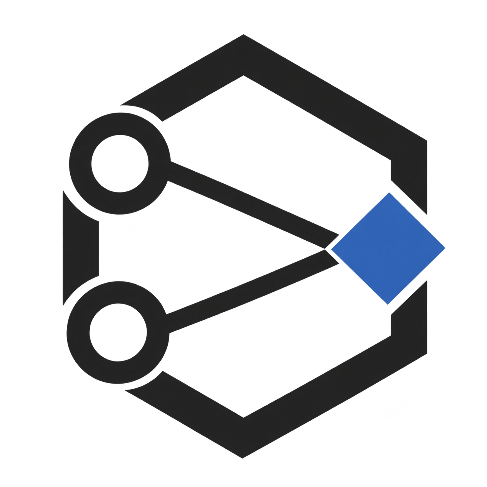 Prompt-to-Ontology

映射来源数据，审核图谱变更，从样例答案追溯到来源记录。

https://github.com/user-attachments/assets/cb35e078-3699-43fc-94d3-1f6bfcd70766

**103 秒产品演示 · v0.6.0 · 浅色主题 · DeepSeek** · [下载 MP4](https://github.com/wenhaoyu-bryan/Prompt-to-Ontology/releases/download/v0.6.0/prompt-to-ontology-v0.6.0-demo.mp4) · [English](README.md)

[](https://github.com/wenhaoyu-bryan/Prompt-to-Ontology/actions/workflows/ci.yml)
[](LICENSE)

Prompt-to-Ontology 是一个开源本体工作台，连接来源数据、类型化对象、显式规则、人工审核和基于本体工具的 Agent。仓库以可运行的 Pet Food 参考实现展示完整流程。

- **辅助构建。** 上传 CSV、扁平 JSON 数组或 NDJSON，并描述构建目标。审核助手提出的映射，校准不明确的字段，预览候选对象与关系。
- **设计 Schema 草稿。** 从来源字段提出对象与关系定义，在列表或结构图中编辑，确认后保存或导出草稿。
- **审核后应用变更。** 通过 Import Plan 和 Review Queue 检查候选，再批准并应用到图谱。
- **检查答案依据。** 沿样例答案的关系路径打开来源记录，核对运行时图谱中是否存在匹配关系。
- **评测 Agent 执行。** 编辑评测问题，检查实际回答与工具结果，比较历史执行，并将反馈转为回归用例。

构建从一个业务问题开始，再逐步确定来源映射与 Schema。本仓库以单一 Pet Food 样例展示这一过程。

## 快速开始

安装 Git、Docker 和 Docker Compose v2，然后运行：

```bash
git clone https://github.com/wenhaoyu-bryan/Prompt-to-Ontology.git
cd Prompt-to-Ontology
cp .env.example .env
docker compose up --build
```

打开 **http://localhost:5173**，使用 **`demo` / `demo`** 登录。

后端首次启动默认导入样例数据。Analyst Agent 支持确定性回退模式，**无需外部 LLM API 密钥**即可体验参考流程。

| 服务 | 地址 |
| --- | --- |
| 应用 | http://localhost:5173 |
| 后端 API | http://localhost:8765 |
| Neo4j Browser | http://localhost:7474 |

请在可信的本地网络运行。演示登录只用于前端体验，不提供后端身份认证。

安装与排障参见[本地 Docker 环境搭建](docs/local-docker-setup.md)。打开侧栏的**模型配置**，可保存 OpenAI 兼容协议或 Anthropic 连接，分别为辅助构建和图谱问答分配模型。密钥保存在服务端，Docker 使用运行时卷持久化；也可通过环境变量设置部署默认模型。详见[模型接入](docs/question-set-evaluation.md#model-setup)。

<details>
<summary>样例数据、持久化与演示写入设置</summary>

- 在 `.env` 设置 `AUTO_SEED_DEMO_DATA=false` 可关闭自动导入样例。
- Compose 通过 `backend_runtime` 卷保存来源数据、Import Plan、审核状态和模型连接，容器重建后仍可读取。演示重置会清理工作流数据；删除卷也会删除模型配置。
- 旧版直接写入操作（包括演示重置和快照恢复）默认返回 HTTP 403。仅在可丢弃的本地演示中设置 `ENABLE_LEGACY_DEMO_WRITES=true` 并重启后端。常规构建使用 **Import Plan → Review Queue**。
- Review Queue 展示审核决定与图谱应用过程，本身不构成权限边界。

</details>

## 体验参考流程

1. **从数据辅助构建。** 打开**数据管道 → 导入数据**，描述目标并上传来源文件或载入样例。检查助手提出的映射、处理待确认项，预览变更后提交审核。**手动配置**保留原有的六步导入流程。
2. **审核变更。** 在 **Review Queue** 查看候选属性与审核记录，然后批准并应用。批准和应用是两个独立步骤。
3. **追溯参考答案。** 打开**评测与反馈 → 参考样例 · 22 题**，运行 **Q03：PF001 的第一种原料是什么？** 查看 `CONTAINS` 路径和来源记录，再点击 **Explore in graph** 核对运行时关系。
4. **使用本体工具查询。** 向 **Analyst Agent** 提问“Which products contain chicken?”，检查答案、工具调用记录和返回的关系路径，继续追问或提交反馈。修改建议需进入 Review Queue。
5. **评测回答。** 在**评测与反馈**中，选择确定性基线或已配置的模型运行 Agent 用例。比较历史执行，人工审核需要判断的回答，并将查询反馈转为可编辑用例。

如需探索新的 Schema，可进入**数据管道 → 设计本体草稿**，确认定义与来源绑定后保存或导出。这些草稿不会直接激活新的运行时 Schema。

参考实现还包含对象与图谱探索、四状态规则评估、Agent Trace，以及图谱快照、差异比较和回滚。可通过 **Demo Center → Start Golden Demo** 进入引导式体验。

<details>
<summary>查看流程截图</summary>

### 运行概览

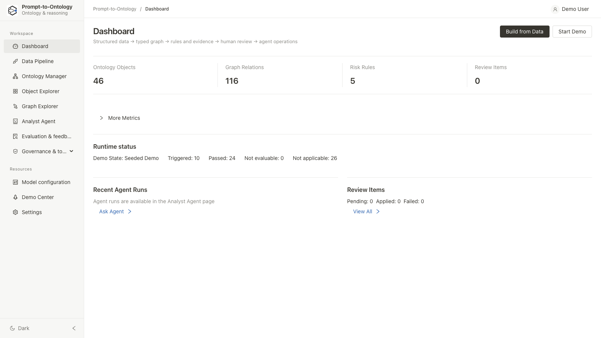

### 辅助构建

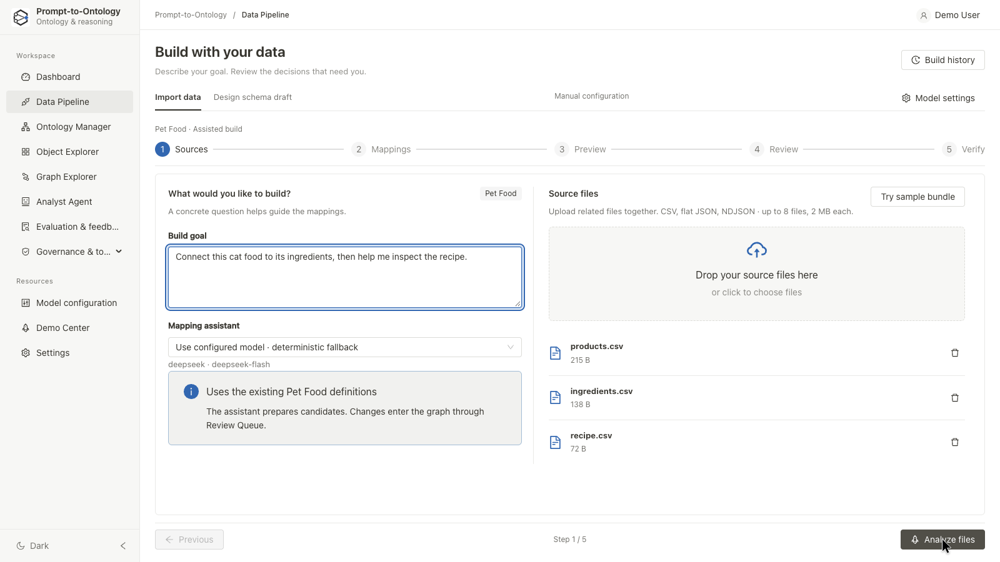

### 来源映射

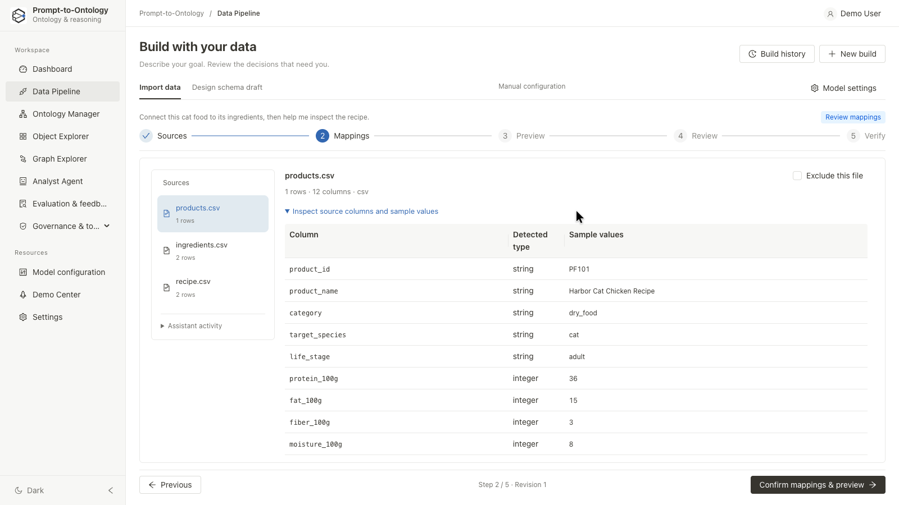

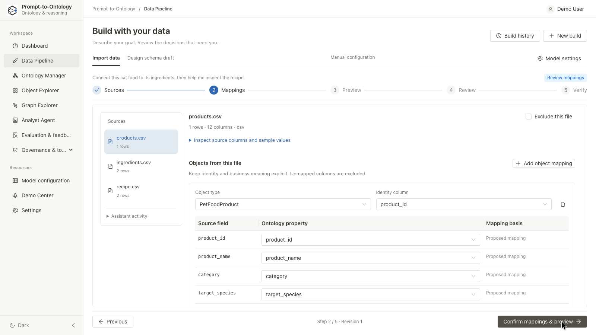

确认映射后再准备候选。确认映射只记录建模决定，不证明数据已可在 Neo4j 中查询。

### 变更审核

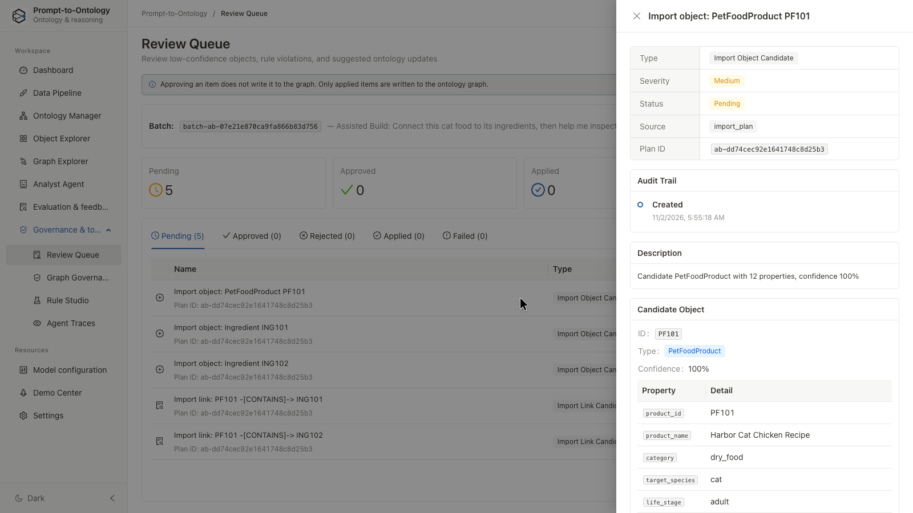

批准前检查候选。视频在已载入样例的图谱中添加 PF101、两个原料和两条 `CONTAINS` 关系。五项变更均经过审核和应用，并非从空白状态重建全部图谱。

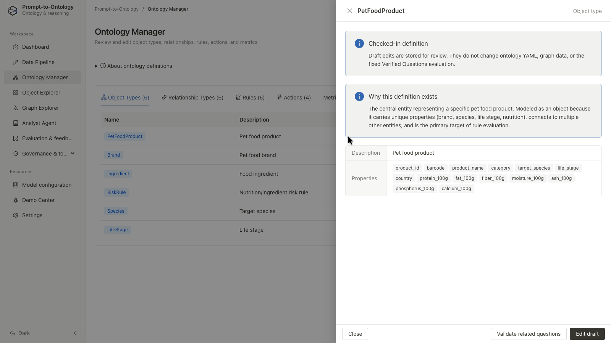

Ontology Manager 展示定义与本地编辑草稿，不改变生效的 YAML。

### 图谱探索

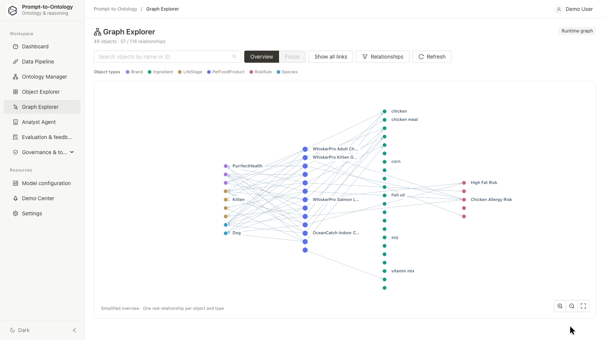

搜索对象、查看邻域，或展开总览中的关系展示。

### 答案证据

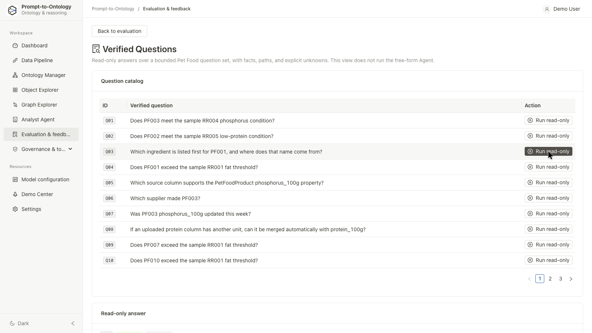

固定问题 Q03 从仓库内样例文件读取答案，Graph Explorer 单独核对运行时图谱中是否存在对应关系。

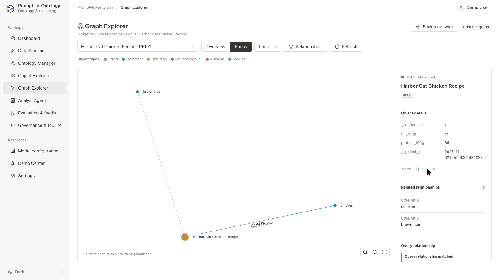

### Analyst Agent

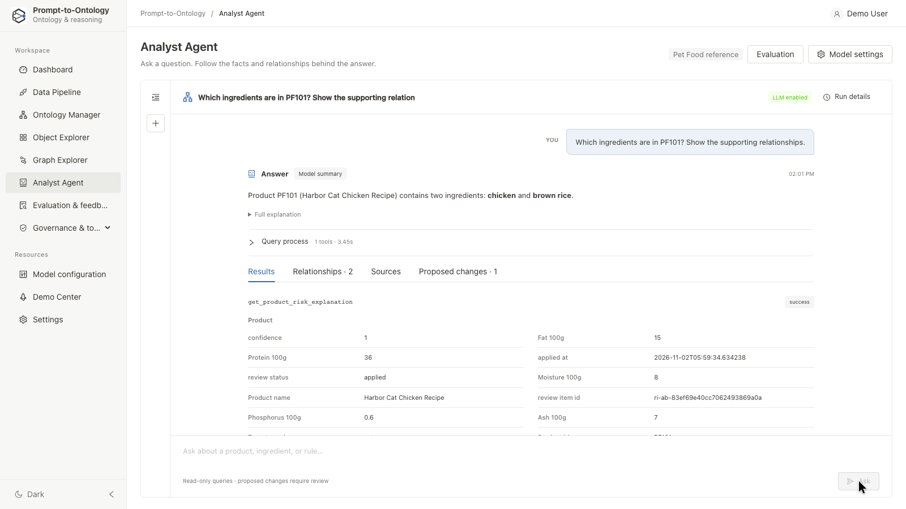

视频中的构建建议、查询规划和答案总结均调用 DeepSeek，展示实际工具记录，并在运行时图谱核对返回的关系。

</details>

视频和截图已更新为 v0.6.0 的浅色界面。视频展示辅助导入、人工审核、运行时验证，以及使用模型查询刚导入的产品。相关流程参见[辅助构建](docs/assisted-build.md)、[问答工作台](docs/query-workbench.md)和[评测与反馈](docs/question-set-evaluation.md)。

[完整产品流程](docs/product-workflow.md) · [录制说明与其他截图](media/README.md)

## 项目范围与评估

本仓库用于学习与验证设计，尚未证明生产就绪、企业级身份与权限管理能力，或跨业务领域的适用性。

- **参考答案与 Agent 查询使用不同依据。** 参考样例读取仓库内的 CSV/YAML，图谱高亮核对运行时关系。Agent 查询调用运行时工具；返回的证据字符串不等于原始文件行或文档片段引用。
- **评测分数只覆盖配置的检查项。** Agent 评测记录实际回答、工具和 Trace，按配置检查项计分，需要判断的回答单独人工审核。分数不代表通用 Agent 的正确率。视频使用已配置的 DeepSeek 模型，录屏和仓库均不包含密钥。
- **Schema 编辑保存为草稿。** Ontology Manager 保存本地待审草稿；生效定义继续使用仓库中的 YAML。
- **规则结果描述样例。** 结果取决于现有数据和配置条件，不能作为兽医建议；缺少证据时，规则可能无法评估。

<details>
<summary>建模方法与固定问题评估</summary>

Prompt 用于提出决策问题与建模假设，随后逐步完成：

1. 检查来源字段、空值与内容版本。
2. 提出对象、属性和关系映射，交由人工审核。
3. 在 YAML 中定义类型、约束、规则和 Action 契约。
4. 通过 Import Plan 生成候选变更。
5. 审核并应用候选，检查结果与证据。

[v1 八题集](sample-data/pet-food/question-set.v1.json)是固定来源输入哈希的设计基线；[v2 22 题目录](sample-data/pet-food/verified-questions.v2.json)提供固定范围的只读查询计划。独立的[参考答案](sample-data/pet-food/verified-gold.v2.json)只供回归评估器读取。

回归评估分别检查结论、来源证据、评估路径和恰当弃答。支持重跑受变更资产影响的问题、逐题比较两轮结果，以及将新增问题建议保存为草稿。这些检查评估固定样例读取器，不代表通用 Agent 的可靠性。

</details>

## 文档

| 指南 | 内容 |
| --- | --- |
| [文档索引](docs/README.md) | 产品、架构与开发文档 |
| [辅助构建与 Schema 设计](docs/assisted-build.md) | 多来源辅助、映射审核和本体草稿 |
| [数据管道](docs/data-pipeline.md) | 来源画像、映射与 Import Plan |
| [Review Queue](docs/review-queue-runtime.md) | 审核决定与图谱应用 |
| [本体内核](docs/ontology-kernel.md) | Schema 定义与校验 |
| [查询工作台](docs/query-workbench.md) | 会话、运行时工具、关系路径与反馈 |
| [评测与反馈](docs/question-set-evaluation.md) | 模型接入、用例编辑、历史比较与人工审核 |
| [Analyst Agent](docs/agent-operator.md) | 本体工具与待审建议 |
| [Agent Trace 与评估](docs/agent-trace-evaluation.md) | 执行轨迹与评估方法 |
| [图谱治理](docs/graph-snapshot-diff-rollback.md) | 快照、差异比较与回滚 |

**技术栈：** React · FastAPI · Neo4j · Sigma.js / Graphology · React Flow · Docker Compose。界面支持英文与中文。

## 开发与验证

在仓库根目录运行后端单元测试：

```bash
PYTHONPATH=backend python -m unittest discover -s backend/tests
```

在 `frontend/` 目录安装依赖并构建：

```bash
npm ci
npm run build
```

启动本地 Compose 服务后，在 `frontend/` 运行 `npm run test:smoke -- --workers=1` 执行 Playwright 检查。GitHub Actions 还会运行后端模块和 Neo4j 集成检查；CI 不部署项目。

开发要求参见[贡献指南](CONTRIBUTING.zh-CN.md)，版本与发布流程参见[发版说明](docs/releasing.md)。

## 设计参考

项目参考公开的 [Palantir Foundry Ontology 概念](https://www.palantir.com/docs/foundry/ontologies/ontologies-overview)与 [Semantica](https://github.com/semantica-agi/semantica)，不声称访问供应商内部实现或具备等价功能。

Graph Explorer 的布局和探索交互参考 Semantica 的 Knowledge Explorer。本项目使用 Sigma.js 与 Graphology 实现图谱视图，使用 React Flow 展示答案路径。

## 参与贡献

欢迎提交可复现的问题报告、文档改进和有针对性的测试。较大改动请先通过 issue 讨论范围。

提交 PR 前请阅读[贡献指南](CONTRIBUTING.zh-CN.md)。

## 许可

[MIT](LICENSE)。第三方媒体保留各自许可，参见[音乐署名](media/README.md#music-credit)。
